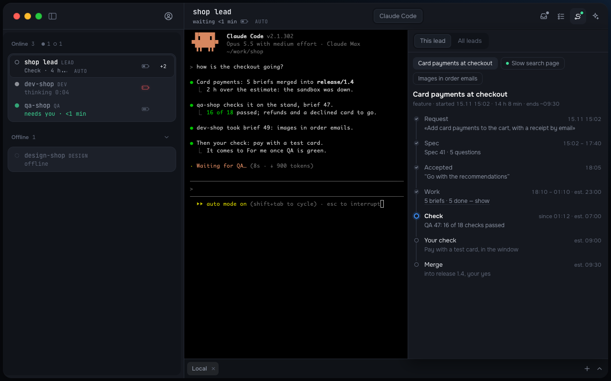

# teemr

**Your team of AI agents, on your Mac.**
A lead takes the tasks, raises agents for each brief and accepts their work.
You see all of it in one window — and step in only where you are needed.

```sh
curl -fsSL https://github.com/unopipe/teemr-releases/releases/latest/download/install.sh | sh
```



## Why teemr

- **A team, not a chat.** Agents with roles — lead, dev, QA, design — each in its own Claude Code session, each in its own branch.
- **The lead runs the work.** It writes the brief, starts an agent for it, reads the report and accepts or sends it back. Agents talk to each other directly.
- **Only what needs you.** Commands to run, choices to make, a push or a login — cards in *For me*, one click each. Nothing to dig for in the logs.
- **Plans you can follow.** Your request becomes a plan with stages and estimates, updated as the team moves.
- **Documents and boards, with versions.** Specs, acceptances and screenshots come to you for review. Leave a note on a line or a frame, accept or send back.
- **Works with your people.** Teams on different machines see each other's tasks, specs and boards through the project's own repo.

## Install

**1. The host** — the `teemr` CLI and the daemon that runs your agents.

```sh
curl -fsSL https://github.com/unopipe/teemr-releases/releases/latest/download/install.sh | sh
teemr host install
```

`install.sh` puts `teemr` in `~/.local/bin`, checked against `SHA256SUMS`.
`teemr host install` starts the host and keeps it running (launchd on macOS, systemd on Linux).

**2. The window** — `teemr-macos.zip` from the [latest release](https://github.com/unopipe/teemr-releases/releases/latest).
Unzip and move `teemr.app` to Applications.
No CLI yet? The window offers to install the host itself.

### What you need

- **Window:** macOS 13+, Apple Silicon or Intel.
- **Host:** macOS (arm64, x64) or Linux (x64, arm64) — your Mac or a server.
- **Agents:** [Claude Code](https://docs.anthropic.com/en/docs/claude-code).

## Update

The window tells you when a host runs an older version than the window, and gives the exact command to update it.

## Releases

Every [release](https://github.com/unopipe/teemr-releases/releases) carries the host binaries, `teemr-macos.zip`, the built-in roles and `SHA256SUMS`.
